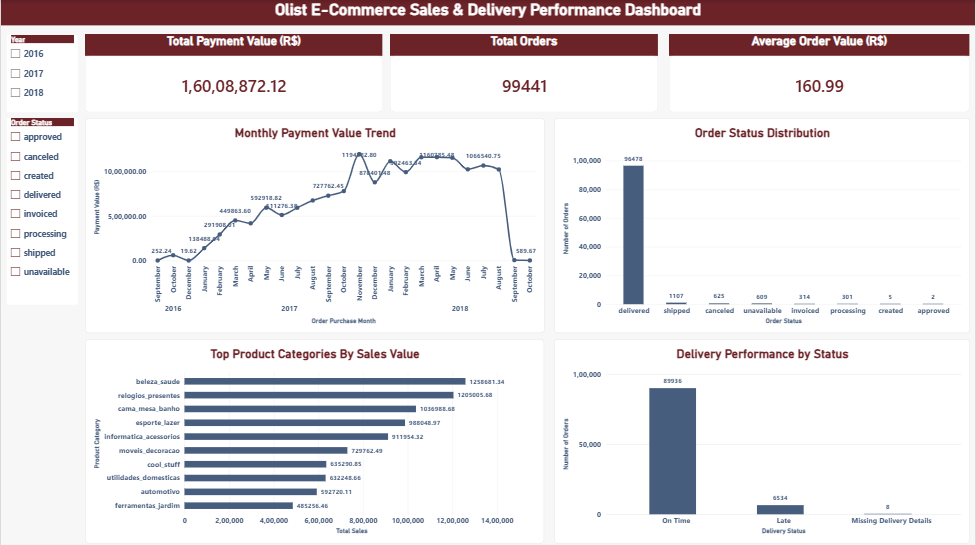

# Olist E-commerce Business Analytics

## Project Overview
An end-to-end business analytics project using the Olist Brazilian e-commerce dataset to analyze sales performance, product categories, and delivery operations. The goal is to generate actionable business insights using data analysis and visualization tools.

## Tools & Technologies
- **Python:** Pandas for data cleaning, transformation, and exploratory data analysis
- **SQL:** SQL queries using DuckDB to analyze data and validate key performance indicators
- **Power BI:** Interactive dashboards and business performance visualization

## Business Questions
- How do sales trends change over time?
- Which product categories contribute most to sales?
- What insights can delivery performance provide about operational efficiency?

## Project Workflow
1. Analyzed and explored the dataset using Python and Pandas.
2. Used SQL and DuckDB to query data and validate key metrics.
3. Built a Power BI dashboard to visualize business performance.

## Key Skills Demonstrated
Data cleaning, exploratory data analysis, SQL querying, KPI validation, data visualization, and business-oriented analytical thinking.

## Project Status
Portfolio project in progress. Additional insights, dashboard screenshots, and detailed findings will be added as the project documentation develops.
## Power BI Dashboard

